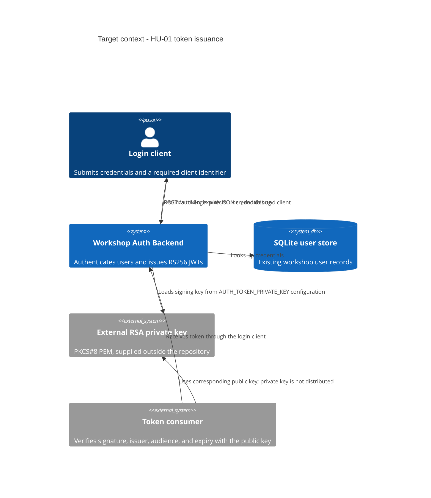
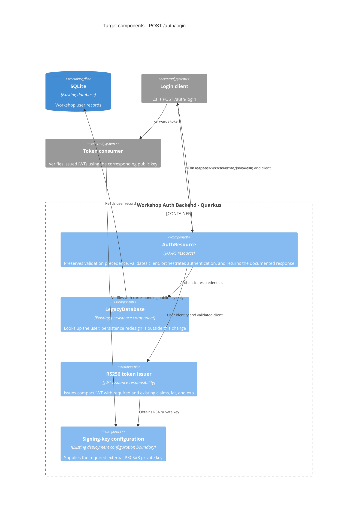

# Design

## Context

See [proposal.md](./proposal.md) for motivation and [specs/auth-token-issuance/spec.md](./specs/auth-token-issuance/spec.md) for the observable requirements.

This design follows the documented Dia 1 contract: `POST /auth/login` issues an RS256 JWT using an externally supplied RSA private key, includes the existing identity/issuer/audience claims, and returns `expiresIn`. Per the approved scope, `client` becomes required, is checked for a non-blank string using `trim()`, and is included without normalization. The Issue's HMAC/`AUTH_TOKEN_SECRET` description is not adopted.

There is a material discrepancy between that contract and the repository's current implementation that must be accounted for during implementation:

- `AuthResource` currently calls `LegacyTokenUtil`, which Base64-encodes username, role, expiry, and a hardcoded secret. It does not create a JWT or provide RS256/HMAC signing.
- The current success response has a fixed `expiresIn: 3600`; there is no configured RSA private-key source in `application.properties`.
- The current resource returns exception details in its HTTP 500 body, and `LegacyDatabase` catches query failures and returns `null`. This differs from the generic HTTP 500 and error separation documented in `docs/ENDPOINTS.md`.
- The existing `AuthResourceTest` covers only a successful login and asserts neither JWT semantics nor the documented error cases.

The diagrams below describe the target boundaries for this change, not the current code structure. The work remains within the authentication endpoint and token issuance; it does not restructure persistence or unrelated endpoints.

## C4 Diagrams

### System context

### Authentication components

## Goals / Non-Goals

**Goals:**

- Keep the existing HTTP route and successful response shape while enforcing the approved `client` rule.
- Replace the insecure legacy token representation with an RS256 JWT consistent with the documented contract.
- Keep token signing material external to the repository and prevent secrets, passwords, and tokens from appearing in logs or error responses.
- Derive `iat`, `exp`, and `expiresIn` from one issuance-time value so the response and token have a deterministic, testable relationship.
- Add focused authentication and token tests without changing unrelated application architecture.

**Non-Goals:**

- Adopt HMAC, change the documented RS256 algorithm, or add a JWT library/dependency in this change.
- Add token verification or authorization endpoints to this backend. Consumers remain responsible for verifying signature, issuer, audience, and expiry.
- Redesign SQLite access, password storage, CORS, health checks, or the broader authentication application.
- Stabilize framework-generated malformed-JSON details that `docs/ENDPOINTS.md` explicitly describes as non-contractual.

## Contracts Protected

- `POST /auth/login` remains unauthenticated and JSON-based.
- On success, preserve HTTP 200 and the top-level `token`, `expiresIn`, `user`, and `debug` fields. Preserve the documented public `user` fields and HTML escaping.
- Preserve the existing validation precedence for null request, username, and password; validate `client` after those checks so errors in existing fields are not reordered.
- Preserve HTTP 401 for invalid credentials and the documented generic HTTP 500 contract for internal failures. Do not expose exception classes, key paths, private-key contents, or secrets.
- Preserve RS256, issuer `workshop-auth-backend`, audience including `workshop-api`, existing `role`, and a one-hour token lifetime. Add the required `client` claim and ensure `expiresIn` matches the remaining lifetime within one second of issuance-time rounding.
- Missing or invalid signing configuration must not trigger a fallback to the legacy Base64 token or any implicit default secret.

## Components Affected

- **`AuthResource`**: add the `client` validation point after current username/password checks; pass the accepted value to the token issuer; build the existing success shape; retain generic external error responses and avoid sensitive logging.
- **Token issuance responsibility**: replace the behavior currently provided by `LegacyTokenUtil`. Produce the documented RS256 JWT and required claims; do not keep the legacy encoded-token fallback.
- **Signing configuration**: align runtime configuration with `AUTH_TOKEN_PRIVATE_KEY` as documented, reading the external PKCS#8 PEM key. Fail clearly and safely if it is missing or invalid; never log key contents.
- **`AuthResourceTest` and focused test support**: characterize current behavior first, then cover the new request, response, signature, claims, expiry, errors, and redaction contracts.
- **`LegacyDatabase`**: no redesign is proposed. Its current query-failure handling conflicts with the documented error contract and must be captured in characterization evidence; any narrowly necessary adjustment to maintain the documented 500-versus-401 distinction should be kept limited to that contract.

## Decisions

### Preserve RS256 and the documented external RSA key

Use RS256 and the existing documented `AUTH_TOKEN_PRIVATE_KEY` path contract. Do not adopt the HMAC/`AUTH_TOKEN_SECRET` description from Issue #10 because it conflicts with `docs/ENDPOINTS.md`, which the proposal designates as the behavior baseline. The user confirmed RS256 for this design.

**Alternatives considered:**

- **HMAC with `AUTH_TOKEN_SECRET`**: rejected for this change because it changes the documented signing contract and would require an explicit scope/spec update.
- **Continue the current Base64 token**: rejected; Base64 is encoding, not a signature, and exposes the hardcoded secret and token contents.
- **Choose a new JWT library**: deferred/out of scope under the approved proposal, which excludes a new dependency or library decision.

### Use existing JDK cryptography and JSON runtime; no new dependency

Use the JDK RSA signature provider (`SHA256withRSA`) for RS256 and the repository's existing JSON runtime for JWT header/payload serialization. Keep compact JWT formatting and Base64URL encoding deterministic. Centralize the signing responsibility rather than retaining the static legacy encoder. Add no Maven dependency.

**Alternatives considered:**

- **Add a JWT library**: can reduce custom token-format risk, but is excluded by the approved proposal and needs a separate scope decision.
- **Implement cryptographic primitives manually**: rejected; use standard JDK cryptography rather than custom cryptographic algorithms.

### Validate `client` without silently normalizing it

Require a string value that is not empty after `trim()`. Preserve the exact accepted request value in the `client` claim, as specified. Do not invent a maximum length, allow-list, or normalization rule in this change.

**Alternatives considered:**

- **Keep `client` optional**: rejected by Issue #10 and the approved spec.
- **Trim and store the normalized value**: rejected because the spec requires the accepted value to be reflected without normalization.
- **Add a client registry or allow-list**: rejected as new policy and data scope not present in the Issue.

### Derive lifetime values from one issuance timestamp

Capture issuance time once at whole Unix-second precision; set `iat` to that value and `exp` to `iat + 3600`. Derive the response's `expiresIn` from the same expiration and issuance-time value. The contract's one-second tolerance accounts for integer-second rounding; tests should compare against the defined issuance time rather than assume that network delivery occurs in the same second.

**Alternatives considered:**

- **Keep `expiresIn` hardcoded independently of the JWT**: rejected because the two values could diverge.
- **Change the one-hour lifetime**: rejected because it would alter the existing documented token contract.

## Incremental Strategy

1. **Characterize before changing token or error behavior.** Run focused black-box tests against the current branch with an isolated SQLite database. Record actual status codes, response fields, display-name escaping, current Base64 token format, `expiresIn`, invalid-credential behavior, framework handling of malformed requests, and current exception/log behavior. Mark differences from `docs/ENDPOINTS.md`; do not mistake current behavior for the approved target contract.
2. **Add contract tests for request validation and response compatibility.** Cover required `client` cases, validation precedence, stable success fields, public user shape, and the documented application error responses.
3. **Replace only token issuance/configuration.** Use the external RSA key; verify compact JWT structure, RS256 signature, required and preserved claims, and the relationship between `iat`, `exp`, and `expiresIn`. Keep the existing route and database flow.
4. **Close security and failure-path tests.** Confirm absent/invalid key fails safely without a fallback; verify invalid credentials remain 401, internal errors do not disclose details, and sensitive values do not appear in captured logs.
5. **Run the focused authentication test class, then the repository test suite.** Update `docs/ENDPOINTS.md` only where the approved `client` requirement or `expiresIn` semantics change; do not rewrite unrelated endpoint documentation.

## Characterization Tests Before Critical Changes

Before replacing `LegacyTokenUtil` or changing error handling, capture these current-branch observations using fake credentials and a disposable database:

- A successful login's status, content type, response keys, `user` shape, escaped display name, `debug`, and current fixed `expiresIn`.
- The current token is Base64-encoded legacy content, not a three-segment JWT; record this as an implementation gap, not behavior to preserve.
- Existing 400 behavior for null request and missing/blank username/password, including validation precedence when multiple fields are invalid.
- Existing 401 behavior for unknown user and wrong password.
- Current database failure handling and current HTTP 500 body/log behavior, using an isolated database setup that cannot damage `data/workshop.db`.
- Current handling of absent, null, blank, and non-string `client`; the field is presently not validated.

These are characterization observations only. Where current behavior conflicts with the proposal/spec or the Dia 1 baseline, tests for the final contract must assert the approved contract rather than freeze the discrepancy.

## Proposed Automated Test Cases

- **Request validation:** missing `client`, JSON `null`, `""`, and whitespace-only values return application HTTP 400 with no token; a non-string JSON type returns HTTP 400 without asserting an unstable framework-generated body; a nonblank value with surrounding whitespace is preserved exactly in the claim.
- **Validation precedence:** null request, invalid username, and invalid password retain their documented precedence before `client` validation.
- **Successful response compatibility:** HTTP 200, JSON content type, `token`, integer `expiresIn`, `user`, and `debug`; `user` includes only documented public fields, with escaped `displayName`.
- **JWT structure and signature:** exactly three Base64URL segments, `alg=RS256`, valid signature verified with a test public key, and no private key or secret in the header/payload.
- **Claims:** `sub`, requested `client`, `iat`, `exp`, `role`, `iss`, and `aud` including `workshop-api` have expected values.
- **Lifetime:** `exp = iat + 3600`; `expiresIn` is positive and differs from the remaining lifetime at issuance by no more than one second.
- **Authentication failures:** wrong password and unknown user retain the documented HTTP 401 response and never return a token.
- **Signing configuration failures:** missing, unreadable, or invalid RSA private key does not issue a token or fall back to the legacy encoding; externally visible errors remain generic and logs do not include key material.
- **Error and log redaction:** capture application responses/logs for success, invalid credentials, and token-issuance/internal failures; assert they contain no password, JWT, private key, or signing secret.
- **Expiry consumer boundary:** assert the issued JWT's `exp` is a valid Unix-seconds claim and that the token is expired after that instant. The backend has no token-verification endpoint, so rejection by an actual downstream consumer is not an in-repository behavior test unless a consumer verifier is added in a separately approved scope.

## Risks / Trade-offs

- **Current code and documented contract diverge substantially** → Characterize current behavior first, but use the approved spec and Dia 1 contract as the target; keep the correction localized to login/token issuance and directly coupled error handling.
- **JDK primitives avoid dependencies but leave JWT serialization/claim assembly in application code** → Keep that logic in one issuance boundary, use standard JSON/Base64URL/signature APIs, and verify signature and claim structure in automated tests. Revisit a JWT library only through an explicit scope/spec change.
- **RSA key parsing or permissions fail at runtime** → Validate key configuration at startup, fail closed, and never provide a default or legacy-token fallback; do not log key contents.
- **Making `client` required breaks callers that omit it** → Treat this as the explicitly approved contract change; update integration documentation and clients in a coordinated rollout.
- **`expiresIn` may be interpreted relative to response receipt by consumers** → Define comparison relative to issuance time and allow the documented one-second rounding tolerance; do not change the one-hour `exp - iat` lifetime.
- **Error handling changes can mask operational causes** → Keep detailed causes only in restricted server logs, while returning the generic documented HTTP 500 response; never include credentials or signing material in either channel.
- **A rollback can reintroduce insecure, incompatible tokens** → Do not restore the legacy Base64 path as a fallback. Roll back the release as a unit and ensure callers are compatible with the previous documented contract; there is no database migration to reverse.

## Rollback

This change has no database schema migration. If the new release cannot start because RSA key configuration is invalid, correct the external key/configuration or roll back the application release; do not switch to a default secret or the legacy encoder. If callers cannot yet provide the required `client`, roll back the application and caller rollout together. Preserve the private key outside version control and do not alter or delete it as part of application rollback.

## Open Questions

None for this design: RS256 was selected to preserve the documented baseline. Downstream token-verifier behavior remains outside this backend's scope.
